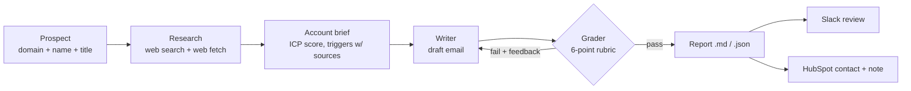

# AI SDR Agent

**Give it a company domain and a person. It researches the account, finds a "why now" trigger, writes a short cold email, grades the email with a separate reviewer, and rewrites it until it passes.** Results go to a markdown report, Slack, and HubSpot.

Most "AI SDR" demos stop after the first draft. This one treats the draft as something to check. Every claim about the prospect has to trace back to a cited source, and a grader rejects drafts that are generic, too long, or that make things up.

```
$ python -m sdr_agent batch data/prospects_demo.csv --demo

Researching quillstack.example
  2 sources found
Building account brief
  ICP fit 64/100, 1 triggers
Writing draft 1
  graded 3.8/5 -> FAIL      # draft said "40-person sales team" and "Salesforce"; neither is in the research
Writing draft 2
  graded 4.7/5 -> PASS

┏━━━━━━━━━━━━┳━━━━━━━━━━━━━━━━━━━┳━━━━━┳━━━━━━━━━━┳━━━━━━━┳━━━━━━━━━━┓
┃ Prospect   ┃ Company           ┃ ICP ┃ Attempts ┃ Grade ┃ Status   ┃
┡━━━━━━━━━━━━╇━━━━━━━━━━━━━━━━━━━╇━━━━━╇━━━━━━━━━━╇━━━━━━━╇━━━━━━━━━━┩
│ Dana Reyes │ Northwind Freight │ 88  │ 2        │ 4.8   │ approved │
│ Marcus Lee │ BrightPath Health │ 81  │ 1        │ 4.7   │ approved │
│ Priya Nair │ Quillstack        │ 64  │ 2        │ 4.7   │ approved │
└────────────┴───────────────────┴─────┴──────────┴───────┴──────────┘
```

## How it works



| Step | What happens | Output |
|---|---|---|
| **Research** | Claude uses web search and web fetch to collect company facts and recent events (funding, hiring, leadership changes, launches, CRM migrations) and keeps the source URL for each. | `ResearchNotes` |
| **Brief** | Turns the notes into structured data: ICP fit score against [`config/seller.md`](config/seller.md), likely pains, persona angle, and triggers. Each trigger must cite a URL from the research. | `AccountBrief` |
| **Write** | Drafts a 60-110 word email that opens with a trigger, links it to one pain, adds one proof point, and ends with a low-friction question. | `EmailDraft` |
| **Grade** | A separate reviewer prompt scores personalization, relevance, grounding, clarity, CTA and brevity from 1 to 5, and lists any claim the brief doesn't support. The pass rule itself (average ≥ 4, nothing below 3, no unsupported claims, 60-110 words) is enforced in code, not left to the model. | `Grade` |
| **Revise** | If the draft fails, the reviewer's feedback goes back to the writer. The default is up to 2 rewrites. A draft that still fails is marked *needs human edit* rather than sent. | `SDRResult` |

Every step returns a typed [Pydantic](sdr_agent/models.py) object through Claude's structured outputs, so later steps never parse free text.

## Design choices

- **Grounding over polish.** The writer may only use facts from the brief, and the grader lists unsupported claims. Any unsupported claim fails the draft, whatever its score. A made-up "congrats on your 40-person team" costs more trust than a plain email.
- **Separate writer and grader.** The model grades its own work against an explicit rubric in a different prompt and context, which catches far more than "write a good email" alone.
- **Human in the loop.** Slack gets the draft, the triggers with source links, and the grade, so a rep can check the email in 10 seconds before sending it. Nothing is sent automatically.
- **CRM as the system of record.** HubSpot sync upserts the contact by email to avoid duplicates and attaches the brief and draft as a Note, so the context stays with the record.
- **Seller context is a file.** To point the agent at a different product, ICP or persona, edit [`config/seller.md`](config/seller.md). No code changes.
- **Runs without keys.** Demo mode replays recorded outputs for three fictional companies, so anyone can clone the repo and see the full loop in seconds.

## Quickstart

```bash
git clone https://github.com/Nikhil221808/ai-sdr-agent.git
cd ai-sdr-agent
python -m venv .venv && source .venv/bin/activate
pip install -e ".[dev]"

# Offline demo: no API keys needed
python -m sdr_agent batch data/prospects_demo.csv --demo
open outputs/   # one .md report and one .json file per prospect

pytest          # 21 tests, all offline (the Claude backend is tested against a mocked HTTP layer)
```

### Live mode

```bash
cp .env.example .env    # add ANTHROPIC_API_KEY (Slack and HubSpot are optional)

# One prospect
python -m sdr_agent run --domain example.com --first-name Jane --last-name Doe \
  --title "VP of Sales" --email jane@example.com

# A list, with Slack review and HubSpot sync
python -m sdr_agent batch my_prospects.csv --slack --hubspot
```

CSV columns: `company_domain, first_name, last_name, title, email, linkedin_url` (see [`data/prospects_template.csv`](data/prospects_template.csv)).

| Flag | Default | |
|---|---|---|
| `--demo` | off | Replay fixtures instead of calling Claude |
| `--seller` | `config/seller.md` | Your product, ICP, personas and proof points |
| `--max-revisions` | `2` | Rewrites before handing off to a human |
| `--threshold` | `4.0` | Grader pass mark (1-5) |
| `--slack` | off | Post to `SLACK_WEBHOOK_URL` |
| `--hubspot` | off | Upsert contact + note with `HUBSPOT_TOKEN` |
| `--model` | `claude-opus-5-5` | Or set `SDR_MODEL` |

### Integrations setup
- **Slack:** create an [incoming webhook](https://api.slack.com/messaging/webhooks) and set `SLACK_WEBHOOK_URL`.
- **HubSpot:** in a free developer or test account, create a private app with `crm.objects.contacts.read` and `crm.objects.contacts.write` scopes, then set `HUBSPOT_TOKEN`.

## Project structure

```
sdr_agent/
  pipeline.py          research -> brief -> draft -> grade -> revise loop
  backends.py          ClaudeBackend (live) and DemoBackend (fixtures)
  prompts.py           every prompt, in one file
  models.py            Pydantic schemas for each step
  render.py            markdown report
  integrations/
    slack.py           Block Kit review message
    hubspot.py         contact upsert + note with association
  cli.py               `run` and `batch` commands
config/seller.md       seller context (edit this)
fixtures/demo/         recorded runs for 3 fictional companies
tests/                 offline tests (pipeline, Slack payload, HubSpot via mock transport)
```

## Implementation notes

- Uses the Anthropic Python SDK with `claude-opus-5-5`: adaptive thinking, `effort` tuned per step (`high` for writing, `medium` for research, briefs and grading), and server-side refusal fallbacks.
- Research uses Claude's server-side `web_search` and `web_fetch` tools and handles `pause_turn` for long searches.
- In a batch, one failed prospect is logged and skipped; it doesn't stop the run.

## Roadmap

- [ ] Eval set: score 50 real drafts by hand and measure how often the grader agrees
- [ ] Multi-step sequences (follow-up emails 2 and 3 that reference email 1)
- [ ] Push approved drafts into a sequencer (Apollo, Outreach, Smartlead) instead of only HubSpot
- [ ] Batch API for large lists (half the cost, async)

---

*The demo companies, people and URLs are fictional (`.example` domains). "Pipewise" is a made-up seller used to show how the seller context works.*
